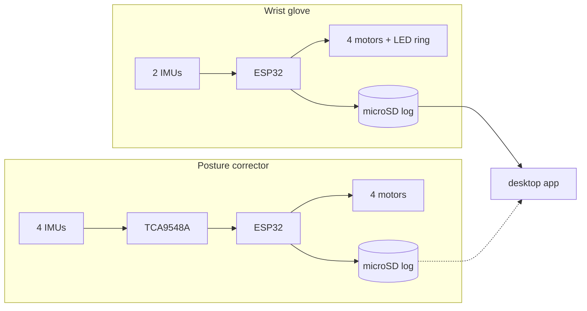

# Wearable Posture Devices

Firmware, documentation and development logs for two ESP32 wearables that buzz when a joint or the back moves past a set angle: a **wrist rehabilitation glove** and a **posture corrector**. They are separate projects that share a platform and some ideas, so their thresholds, formulas and pin maps differ on purpose.

> **Status: two working prototypes, with no validation yet.**
>
> - Both firmwares do what their code says. The wrist glove's seven development recordings ([`data/`](data/)) are consistent with its thresholds, and a device lying still stays within 1.3 degrees of zero.
> - **No accuracy has been measured for either device.** There is no protractor, goniometer, motion-capture or clinician reference, so nobody has checked that a reported angle matches the body.
> - **No outcome has been measured.** Nothing here claims that either device helps anyone's wrist or posture.
> - The posture corrector has no recordings in this repo. The wrist glove's recordings are development tests, not a study.
> - Neither is a medical device. Read [`docs/LIMITATIONS.md`](docs/LIMITATIONS.md) first.
> - Superseded work (an earlier wrist build with a flex sensor and a cloud connection, and bench sketches) is kept in [`archive/`](archive/).

## The two devices

| | Wrist glove | Posture corrector |
|---|---|---|
| Goal | warn when the wrist bends past a set range | warn when the back, shoulders or neck drift from an upright posture |
| Sensors | 2 x LSM6DS3TR-C + LIS3MDL, one I2C bus | 4 IMUs of the MPU-6050 family behind a TCA9548A multiplexer |
| What drives the output | tilt difference between the two sensors, accelerometer only | each sensor's tilt compared with its value at calibration, accelerometer only |
| Calibration | 3 s at start-up, average becomes zero | 5 s at start-up, average becomes zero |
| Thresholds | 30 degrees (flexion, extension), 13 degrees (left, right) | 18 degrees on all three rules |
| Output | 4 motors (one per direction) + 16-LED ring | 4 motors (3 for the back, 1 for the neck) |
| Logs | microSD CSV every 0.5 s, USB transfer | microSD CSV every 2 s, USB serial commands |
| Firmware | [`newVariant.ino`](wrist-glove/firmware/newVariant/newVariant.ino) | [`PostureCorrector.ino`](posture-corrector/firmware/PostureCorrector/PostureCorrector.ino) (v4.1) |
| Docs | [README](wrist-glove/README.md), [METHODS](wrist-glove/METHODS.md), [HARDWARE](wrist-glove/HARDWARE.md) | [README](posture-corrector/README.md), [METHODS](posture-corrector/METHODS.md), [HARDWARE](posture-corrector/HARDWARE.md) |



The dashed line is a file copy by hand: the desktop app can download logs over USB only from the wrist glove.

## Framing notes

- **The code is the source of truth.** Every value in the READMEs was read from the firmware or computed from the logs, and the pages say so. Anything the code cannot show (sensor placement, motor drivers, power, parts) is listed as "not documented" instead of guessed.
- **Differences between the two devices are not errors.** The formulas, sign conventions and thresholds were written separately.
- **"Yaw" on the wrist glove is a roll difference.** An accelerometer cannot measure rotation about the vertical axis ([`docs/IMU_AND_ANGLES.md`](docs/IMU_AND_ANGLES.md)).
- **Some firmware comments were not trusted.** They cite ergonomic and clinical ranges, storage lifetimes and dead-zone values that do not match the constants or were not checked. The method pages list each one.

## Structure

```
README.md                           this file
LICENSE                             MIT
docs/
  LIMITATIONS.md                    what the devices cannot be trusted for
  IMU_AND_ANGLES.md                 tilt from an accelerometer, and its limits
  REFERENCES.md                     the two sources that were opened and checked
  figures/log_overview.png          the wrist recordings plotted
wrist-glove/                        CURRENT
  firmware/newVariant/              final firmware
  README.md  METHODS.md  HARDWARE.md  images/
posture-corrector/                  CURRENT
  firmware/PostureCorrector/        firmware v4.1
  README.md  METHODS.md  HARDWARE.md  images/
data/                               7 wrist development recordings + summary table + SHA-256s
desktop-app/                        CURRENT: viewer for the CSV logs (Python, customtkinter)
tools/                              summarize_logs.py, make_diagrams.py
archive/                            superseded
  wrist-prototypes/                 cloud build with a flex sensor and Madgwick filter
  hardware-tests/                   bench sketches
```

## What the recordings show


Six session recordings of 25 to 87 minutes and one bench recording of the device lying still, from 2026-07-08 to 2026-07-15. The table and the caveats (unexplained outliers, one file with an offset, half a file with a yaw of exactly 0) are in [`data/README.md`](data/README.md). The recordings are labelled development tests because nothing in the files shows how the device was worn.

## Reproducing the numbers and figures

```bash
python tools/summarize_logs.py            # prints the table in data/README.md
python tools/summarize_logs.py --figure   # also redraws docs/figures/log_overview.png
python tools/make_diagrams.py             # redraws the diagrams in the two images/ folders
```

The first command needs only the Python standard library; the other two need matplotlib.

## Building and running

- **Firmware.** Open the `.ino` in the Arduino IDE with an ESP32 board package. Library lists are in each device's `HARDWARE.md`. The versions used were not recorded, and the sketches were not rebuilt for this repo. The wrist sketch has `YOUR_WIFI_SSID` and `YOUR_WIFI_PASSWORD` placeholders to fill in locally and not commit.
- **Desktop app.** `pip install -r desktop-app/requirements.txt`, then `python visualizer.py` from inside `desktop-app/` ([`desktop-app/README.md`](desktop-app/README.md)).

## License

MIT, see [`LICENSE`](LICENSE).
