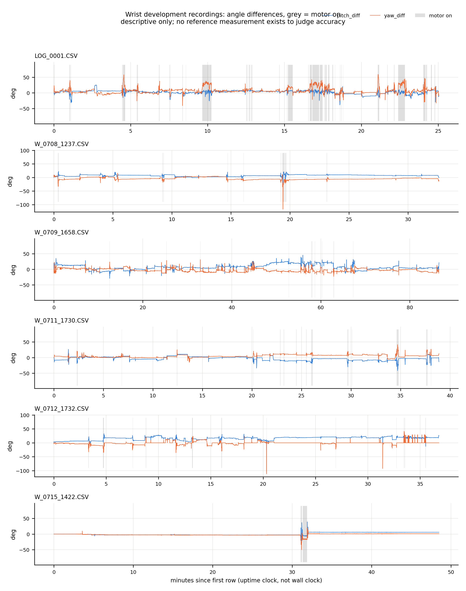

# Data: wrist development recordings

> **These are development test recordings from the wrist glove, not a study.** There is no reference measurement (protractor, motion capture, clinician) for any of them, so nothing here says whether the angles are accurate. The numbers below only describe what the files contain.

## What is here

```
data/wrist/sessions/   6 long recordings (25 to 87 minutes each)
data/wrist/bench/      1 recording of the device lying still (17 minutes)
```

The recordings were written to the SD card by an earlier build of the wrist firmware, on 2026-07-08 to 2026-07-15 (`LOG_0001.CSV` has no date in its name). Each file has the header `elapsed_sec,pitch_diff,yaw_diff,vibra_active` and one row about every 0.5 s.

- `elapsed_sec` is whole seconds since the ESP32 powered on (an uptime clock, not wall time), so about two consecutive rows share each value.
- `pitch_diff` and `yaw_diff` are the smoothed angle differences in degrees, as in [`wrist-glove/METHODS.md`](../wrist-glove/METHODS.md). Note that `yaw_diff` is computed from roll, not from a true yaw.
- `vibra_active` is 1 while any motor was on, and lags the actual trigger by one loop.

The current firmware writes two `#` comment lines before the header (`# Session started:` and `# Device:`). These files come from the build before that, so they have none. `tools/summarize_logs.py` skips `#` lines, so it reads both kinds.

## Summary

Produced by `python tools/summarize_logs.py`. Angles in degrees, "% rows vibrating" is the share of rows with `vibra_active = 1`, and "onsets" counts 0 to 1 transitions.

| group | file | rows | minutes | % rows vibrating | onsets | pitch median | yaw median | max abs pitch | max abs yaw |
|---|---|---:|---:|---:|---:|---:|---:|---:|---:|
| sessions | LOG_0001.CSV | 2994 | 25.1 | 16.7 | 93 | 4.0 | 5.0 | 38.8 | 59.3 |
| sessions | W_0708_1237.CSV | 3896 | 32.6 | 1.7 | 20 | 7.6 | -5.2 | 27.7 | 116.8 |
| sessions | W_0709_1658.CSV | 10332 | 86.6 | 1.1 | 52 | 5.7 | -3.3 | 45.5 | 31.3 |
| sessions | W_0711_1730.CSV | 4643 | 38.9 | 2.9 | 36 | -3.1 | 4.5 | 41.7 | 41.5 |
| sessions | W_0712_1732.CSV | 4398 | 36.8 | 2.5 | 56 | 17.8 | 0.0 | 36.8 | 111.6 |
| sessions | W_0715_1422.CSV | 5660 | 48.5 | 1.6 | 8 | -2.6 | -2.5 | 39.4 | 50.3 |
| bench | W_0715_1324.CSV | 2072 | 17.3 | 0.0 | 0 | 0.0 | -0.1 | 1.2 | 1.3 |



## What can and cannot be read from them

- **Why these seven.** The folder they came from held 35 CSV files. Five contain only a header. Twenty-three are shorter recordings (under 17 minutes each) that looked like handling, shake or bench tests, and they are not included. The six `sessions/` files are the long recordings with slow, varied signal; the one `bench/` file is flat. That grouping was inferred from the signal alone. Nothing recorded in the files says how the device was worn or by whom.
- **The bench file is a noise floor.** While the device lay still, both angles stayed within 1.3 degrees of zero and the motors never fired. That says the sensor pair and the 3 s startup calibration produce a steady zero at rest. It does not say the angles are right when the wrist moves.
- **Thresholds look consistent with the code.** Across the session files the motors turn on when `yaw_diff` is around 10 to 13 degrees and `pitch_diff` is around 29 to 37 degrees in magnitude, matching the 13 and 30 degree constants in the firmware (with 2 degrees of hysteresis). That checks the firmware does what its constants say; it is not a validation of the thresholds themselves.
- **Unexplained outliers.** `W_0708_1237.CSV` reaches a yaw of 116.8 degrees and `W_0712_1732.CSV` 111.6 degrees, far beyond anything else in the files. They were not investigated. A sensor knock, a roll-angle wrap or a glitch are all possible.
- **One file has an offset.** `W_0712_1732.CSV` has a median pitch of 17.8 degrees, much higher than the others. A calibration made in an unusual pose, or a different mounting, would produce that; the cause is unknown.
- **Half of `W_0712_1732.CSV` has a yaw of exactly 0.** That is 2263 of its 4398 rows, and 2253 of them have a pitch above 15 degrees. It fits the firmware's "anatomical correction", which zeroes positive `yaw_diff` while pitch is above 15 degrees, together with the file's high pitch offset. It means the yaw column of that file says little about the rows where it is 0.
- **`LOG_0001.CSV` vibrates far more than the rest.** 16.7% of its rows have a motor on, against 1 to 3% in the others. The reason is not recorded.
- **Sampling.** About 2 rows per second, with the SD card opened and closed for every row. Only `W_0715_1422.CSV` has gaps of 2 s or more in `elapsed_sec` (11 of them, the longest 18 s).

## Provenance

The files were copied from the author's project folder. Their only change is the line endings: the originals end rows with `\r\r\n`, which makes some tools read each row three times. The copies here replace every `\r` with `\n` and drop the blank lines this leaves; no value was altered. Both sets of SHA-256 hashes are listed so the copies can be checked against the originals.

| file | SHA-256, original | SHA-256, as stored here |
|---|---|---|
| LOG_0001.CSV | `9a8b8b30e6152d6bd92c46911b5215552327b40d56a649e762c49046be51821c` | `6363a2e3260bc7d46e2ab645c3d82bd36eb57e6b75188151655ce3f10036037b` |
| W_0708_1237.CSV | `9ab6e62837f07620e9c00b2bf2c7211ccfa6b7e2b1faff21094c0ab0ce3a5f32` | `d939d1adcf16cbd74dde8bbfbbd6038013014c59e6ea9e7779618609afae1d86` |
| W_0709_1658.CSV | `aeb6bf78a40e001927b0fd7c20a10bb08580b38d6fc973f3c472a717b14e0c1d` | `f1887c26f79916b7261751bda4ccc7f79e1de1756fa1c69db3793803deefcaac` |
| W_0711_1730.CSV | `c3c003477a780a4193f9b521b5dbca606aae0ebeb462b03c0c791b578ef4cb57` | `549d76cca9bb971ad7f0e600b0f8abef264a3bce3376a5f5354318ea75e9c17f` |
| W_0712_1732.CSV | `e723c11129050232057f5533130b43ec17f64241b5bb57a26893e1c03dbe4ad9` | `340df0da5f979c16f1357d6d26858975ece6e43b6768c93d736ef1e4cdb4316b` |
| W_0715_1422.CSV | `a89779c79c4efb883705074346db8ccacaa8bd23b15087952efa6f4b3d39709d` | `9c937b9f11601fbca33e0ed8ad504a38719d7b5964945a90fd0a5de8907d671f` |
| W_0715_1324.CSV | `4168d2069f3f518075ee6fad7c2fd9ad4e40879369e855e89361bd8204525c9c` | `7d1a684030a2c09f8d777121aa703d0562fc687668350a264fa5d3a775cff5d2` |

There are no recordings from the posture corrector in this repo. Its firmware does write `POST_NNNN.CSV` files (see [`posture-corrector/METHODS.md`](../posture-corrector/METHODS.md)), but none have been added.

The two files in `desktop-app/sample_data/` are samples that ship with the desktop app. They are not recordings and are not used in any number above.
