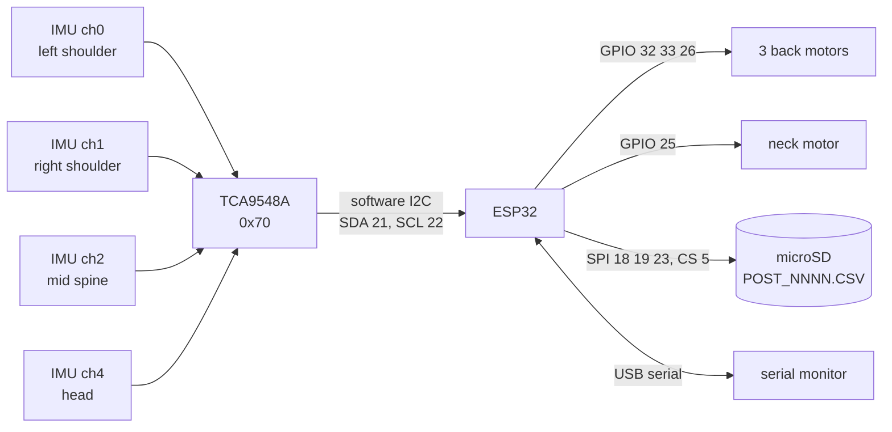

# Posture corrector: hardware

Everything below is read from the firmware ([`firmware/PostureCorrector/PostureCorrector.ino`](firmware/PostureCorrector/PostureCorrector.ino)). There is no schematic, photo, bill of materials or sewing pattern in this repo yet, so anything the code cannot show is listed under "Not documented".

## Pin map (ESP32)

| function | GPIO | notes |
|---|---|---|
| I2C SDA | 21 | bit-banged in software, to the multiplexer only |
| I2C SCL | 22 | |
| Vibration motor, neck | 25 | `VIB_NECK`, PWM through `analogWrite` |
| Vibration motor, left | 33 | `VIB_LEFT` |
| Vibration motor, middle | 32 | `VIB_MID` |
| Vibration motor, right | 26 | `VIB_RIGHT` |
| SD SCK | 18 | pull-up enabled in the firmware |
| SD MISO | 19 | pull-up enabled |
| SD MOSI | 23 | pull-up enabled |
| SD CS | 5 | SPI clock 400 kHz |

## I2C devices

| device | address | channel | position (from the code comments) |
|---|---|---|---|
| TCA9548A multiplexer | 0x70 | n/a | n/a |
| IMU | 0x68 or 0x69 | 0 | left shoulder |
| IMU | 0x68 or 0x69 | 1 | right shoulder |
| IMU | 0x68 or 0x69 | 2 | middle of the spine |
| IMU | 0x68 or 0x69 | 3 | not used |
| IMU | 0x68 or 0x69 | 4 | head (the code comment mentions a 4-pin header on SDA/SCL) |

The multiplexer is there because IMUs of this kind all answer at the same address (0x68 unless a pin is strapped). The IMU behind each channel is addressed after selecting that channel.

On the chip: the firmware wakes the part by writing 0 to register 0x6B, checks that register 0x75 returns 0x68, 0x70 or 0x72, and reads six bytes from 0x3B. The parts list in the author's notes names GY-521 boards (MPU-6050). The code does not confirm the exact chip, and the vendor datasheet could not be opened while this repo was written, so no register-level claim in this repo depends on it.

## Block diagram

## What the firmware needs

- Only built-in libraries: `Wire` (included, not used for the bus), `SD`, `SPI`, and ESP32 system headers.
- It calls `analogWrite` on the ESP32 and picks the task-watchdog API at compile time (`#if ESP_IDF_VERSION >= 5.0.0`), so it builds against both older and newer ESP32 Arduino cores. The version actually used was not recorded.
- It stores the calibration in `RTC_NOINIT_ATTR` memory so that it survives a watchdog reset. A brownout reset is not one of the two reasons that clear it.

## Not documented

These are open, not decided:

- The IMU part number, and how each board is held on the body (the V1 was sewn; there is no photo here).
- What sits between each motor GPIO and its motor (a MOSFET module or transistor is the usual way to do this, but the code cannot show it), and which supply rail drives the motors. Four coin motors and an SD card on the 3.3 V pin of a dev board could brown the board out; this was not tested.
- The SD module's supply voltage (3.3 V or 5 V depends on whether the breakout has its own regulator and level shifter).
- Battery or power bank, and whether the 100 microfarad capacitor mentioned in the author's notes is fitted.
- The motor part and the number of motors in the finished build: the firmware has four motor outputs.
- The `Swapped to match physical harness orientation` comment on the left and right motor pins (see [`METHODS.md`](METHODS.md), section 8).
