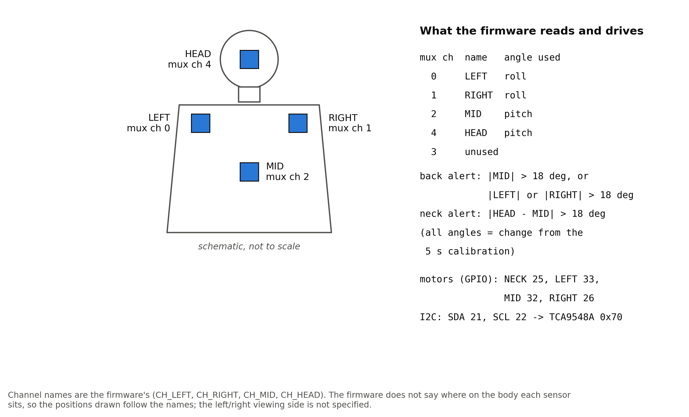
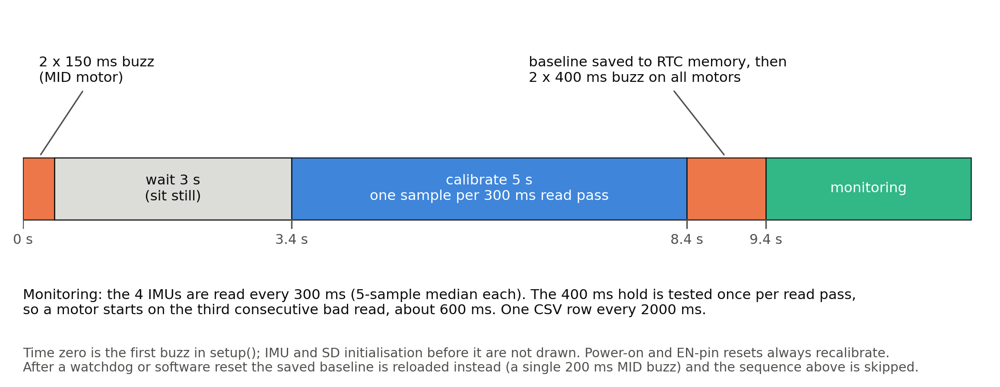

# Posture corrector: methods

What the firmware (v4.1), [`firmware/PostureCorrector/PostureCorrector.ino`](firmware/PostureCorrector/PostureCorrector.ino), does, read from the code. This page describes behaviour. It does not report any measurement of how well that behaviour matches real posture: no reference measurement and no trial data exist (see [`../docs/LIMITATIONS.md`](../docs/LIMITATIONS.md)).

## 1. Sensors

Four IMUs sit behind a TCA9548A I2C multiplexer at address 0x70, one per channel, because they would otherwise share the same address. The firmware tries address 0x68, then 0x69, and accepts a chip whose WHO_AM_I register (0x75) reads 0x68, 0x70 or 0x72.

| channel | name in code | body position (from the code comments) | angle used |
|---|---|---|---|
| 0 | `CH_LEFT` | left shoulder | roll |
| 1 | `CH_RIGHT` | right shoulder | roll |
| 2 | `CH_MID` | middle of the spine | pitch |
| 3 | not used | skipped everywhere | none |
| 4 | `CH_HEAD` | head | pitch |



For each IMU the firmware reads the three accelerometer axes (registers from 0x3B) and computes

```
pitch = atan2(-ax, sqrt(ay^2 + az^2))     in degrees
roll  = atan2( ay, az)                    in degrees
```

Only the accelerometer is used; the gyroscope is never read, so there is no sensor fusion. The firmware does not configure the accelerometer range. Both formulas depend on ratios of the three axes, so the scale cancels out.

Each channel's value (pitch for MID and HEAD, roll for LEFT and RIGHT) goes into a 5-sample history and the **median** of that history is used, which removes single-sample spikes. For the first four passes after power-on the median is taken over fewer samples.

The I2C bus is bit-banged in software on GPIO 21 and 22 (about 4 microseconds per half-bit) rather than driven by the `Wire` library. If no sensor answers in a pass, the bus is reset with nine clock pulses. The reason for bit-banging is not recorded.

## 2. Timing

| constant | value | meaning |
|---|---|---|
| `READ_MS` | 300 ms | all channels are read once per pass |
| `HOLD_MS` | 400 ms | a violation must last this long before its motor starts |
| `SD_MS` | 2000 ms | minimum time between log rows |
| `CALIB_MS` | 5000 ms | calibration window |
| task watchdog | 12 s | resets the board if a pass hangs |

## 3. Boot and calibration



1. On a power-on or external reset, the stored baseline is invalidated. After a watchdog or software reset it is kept.
2. The bus is reset, channels 0, 1, 2 and 4 are initialised (`Ch0:OK` ... printed on serial), the SD card is started and the watchdog is armed.
3. **Fresh boot:** one 150 ms buzz on the middle motor, 100 ms pause, a second 150 ms buzz, then a fixed 3 s wait (the serial prompt is "Sit still - calibrating in 3s..."). Calibration then starts, about 3.4 s after power-on.
4. **Reload after a watchdog or software reset:** the baseline stored in RTC memory is loaded, the middle motor buzzes once for 200 ms, and monitoring starts immediately.
5. During the 5 s window, each 300 ms pass adds the median of every channel to a running sum. That is about 16 or 17 passes.
6. In the first pass at or after 5 s, `baseline[ch] = sum / passes` for every channel. The baseline is written to RTC memory together with a magic number, then all motors buzz twice (400 ms on, 200 ms off, 400 ms on). The baseline is therefore saved about 8.4 s after power-on, before the confirmation buzz ends (about 9.4 s).

The user is expected to sit upright for the calibration. Whatever posture is held then becomes zero for all four channels.

## 4. Monitoring

Once calibrated, every pass computes the deviation from baseline for each channel:

```
dL = median_left  - baseline_left        dM = median_mid  - baseline_mid
dR = median_right - baseline_right       dH = median_head - baseline_head
```

**Back (three motors together):**

- `slouch` is true if `|dM| > 18`.
- If `|dL| > 18` or `|dR| > 18`, the side with the larger absolute value is flagged as tilted (left if they are equal). Only one side is ever flagged per pass.
- `backBad = slouch OR any tilt`.

**Neck (one motor):**

- `dNeck = dH - dM`, the head's deviation relative to the spine's, so that leaning the whole upper body does not count as a neck error.
- `neckBad` is true if the head sensor is active and `|dNeck| > 18`.

All three thresholds (`SLOUCH_THRESH`, `TILT_THRESH`, `NECK_THRESH`) are 18 degrees. They are the author's choices, not clinical values.

The test is on the absolute value, so leaning forward and leaning back are not distinguished, and neither are tilting a shoulder up or down. The firmware has no direction-specific rule.

## 5. Motor output

| output | GPIO | driven by |
|---|---|---|
| MID | 32 | `backBad` |
| LEFT | 33 | `backBad` |
| RIGHT | 26 | `backBad` |
| NECK | 25 | `neckBad` |

A back violation therefore buzzes all three back motors, whichever sensor tripped; the left/right/mid motors do not indicate which side or direction. The neck motor is separate.

- **Delay.** `motorUpdate()` is called once per 300 ms pass. The first bad pass records the time; the motor turns on at the first pass at least 400 ms later. That is the third consecutive bad pass, about 0.6 s after the posture first crossed the threshold. One good pass resets the timer.
- **Drive.** `analogWrite` at 100 for 40 ms (a kick), then 175 of 255. There is no off-time pattern.
- **Blanking.** To keep the motors from shaking the IMUs, all running motors are switched off for about 40 ms at the start of every read pass and restored afterwards.

## 6. Logging

A new file `POST_NNNN.CSV` (numbered from 0001) is created on every boot, including watchdog resets, with the header

```
ms,mid,left,right,head,ctr,lft,rgt,nck
```

and a row is appended, with the file opened and closed each time, no more often than every 2 s and only after calibration:

| column | content |
|---|---|
| `ms` | `millis()` since boot |
| `mid` | `dM`, degrees, 2 decimals |
| `left` | `dL` |
| `right` | `dR` |
| `head` | `dNeck` (the head relative to the spine, not `dH`, despite the name) |
| `ctr` | 1 if `backBad` (slouch or any tilt) |
| `lft` | 1 if the left shoulder was flagged |
| `rgt` | 1 if the right shoulder was flagged |
| `nck` | 1 if `neckBad` |

No posture recordings are included in this repo.

## 7. USB serial

A status line is printed every pass (`<s>s M=.. L=.. R=.. H=.. N=..  OK` or the list of violations, then free heap). Typed commands over the same port:

| command | effect |
|---|---|
| `dump` | print the current log file |
| `list` | list SD files and sizes |
| `read <file>` | print one file |
| `clear` | delete the current log file |

## 8. Comments in the firmware that this repo does not rely on

- The header says that at 2 s intervals the log uses "about 2 MB per day" and that a 16 GB card "lasts 20+ years". That was not measured, so no storage claim is made here.
- Two pin comments say "Swapped to match physical harness orientation". The left and right motor GPIOs may therefore not match the sensor channel of the same name; nothing in the code shows how the harness is built.
