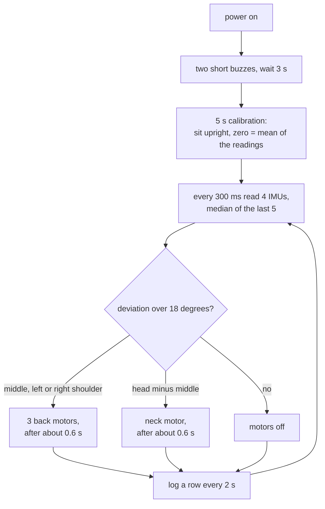

# Posture corrector

A wearable harness with four IMUs (left shoulder, right shoulder, middle of the back, head) that buzzes when the wearer drifts away from the posture they held during a five-second calibration after power-on.

> **Status: working prototype, not validated.**
>
> - The firmware (v4.1) does what its constants say (see [`METHODS.md`](METHODS.md)). It has not been compared with any reference measurement of posture, and **no accuracy is claimed**.
> - **No recordings are included.** The firmware writes `POST_NNNN.CSV` logs, but none have been added to this repo, so there is no results section.
> - The device only measures tilt from gravity: pitch for the back and head, roll for the shoulders. It does not measure shoulder height, and it does not tell forward lean from backward lean.
> - The 18 degree thresholds are the author's choices and were not tested against anyone's posture.
> - This is not a medical device. See [`../docs/LIMITATIONS.md`](../docs/LIMITATIONS.md).

## How it works

All four IMUs answer at the same I2C address, so each is on its own channel of a TCA9548A multiplexer. Whatever posture the wearer holds during calibration becomes zero for every channel; afterwards the firmware compares each channel's median-filtered angle with its zero.




- A back violation buzzes all three back motors together, so the motors do not say which side or direction. The neck motor is separate.
- The neck is judged relative to the back (head minus middle), so leaning the whole upper body does not count as a neck error.
- A watchdog resets the board if a pass hangs 12 s. After such a reset the calibration is kept; after a power cycle it is redone.

| item | value |
|---|---|
| Board | ESP32 |
| Sensors | 4 IMUs of the MPU-6050 family (exact part not recorded) behind a TCA9548A multiplexer |
| Used by the output | the accelerometers only; no gyroscope, no sensor fusion |
| Thresholds | 18 degrees for the middle, shoulders and head-versus-middle |
| Alert delay | the third consecutive bad 300 ms pass, about 0.6 s |
| Logging | microSD CSV, one row per 2 s; read over USB serial with `dump`, `list`, `read`, `clear` |

## Structure

```
posture-corrector/
  firmware/PostureCorrector/PostureCorrector.ino   CURRENT: v4.1
  METHODS.md                                       sensors, calibration, rules, motors, log format
  HARDWARE.md                                      pin map, I2C map, block diagram, what is not recorded
  images/                                          diagrams made by ../tools/make_diagrams.py
../desktop-app/                                    can open the CSV logs (but not download them from this device)
```

## Things to know before building one

- Sit upright and still during the calibration, which starts about 3.4 s after power-on. A calibration made while slouching makes slouching the new zero.
- Left and right motor pins carry the comment "Swapped to match physical harness orientation", so the motor named left may sit on the wearer's right. Check on the bench.
- The sewn V1, motor driver circuit, power rail and SD module voltage are not documented ([`HARDWARE.md`](HARDWARE.md), "Not documented").
- The versions of the Arduino core were not recorded.
