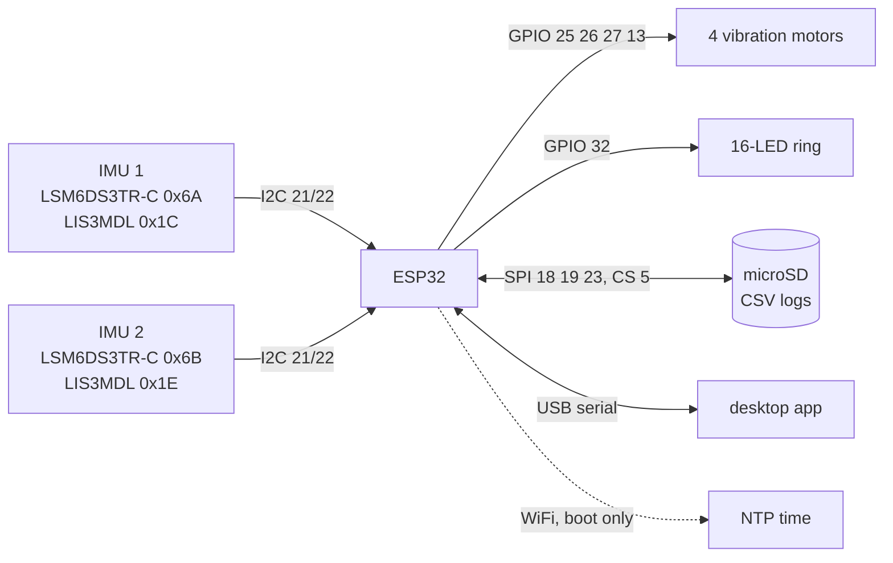

# Wrist glove: hardware

Everything below is read from the firmware ([`firmware/newVariant/newVariant.ino`](firmware/newVariant/newVariant.ino)). There is no schematic, photo, bill of materials or CAD file in this repo yet, so anything the code cannot show is listed under "Not documented".

## Pin map (ESP32)

| function | GPIO | notes |
|---|---|---|
| I2C SDA | 21 | `TwoWire I2C_1`, both IMU boards on this one bus |
| I2C SCL | 22 | |
| Vibration motor 1 | 25 | yaw right / ulnar |
| Vibration motor 2 | 26 | yaw left / radial |
| Vibration motor 3 | 27 | pitch down / flexion |
| Vibration motor 4 | 13 | pitch up / extension |
| NeoPixel ring data | 32 | 16 LEDs, brightness 25 of 255; moved from GPIO 12, the SPI MISO pin |
| SD SCK | 18 | VSPI |
| SD MISO | 19 | internal pull-up enabled in the firmware |
| SD MOSI | 23 | |
| SD CS | 5 | SPI clock 1 MHz |

## I2C devices

| device | address | use |
|---|---|---|
| LSM6DS3TR-C, sensor 1 | 0x6A | accelerometer (used), gyroscope (read, unused) |
| LIS3MDL, sensor 1 | 0x1C | magnetometer (read, unused) |
| LSM6DS3TR-C, sensor 2 | 0x6B | accelerometer (used), gyroscope (read, unused) |
| LIS3MDL, sensor 2 | 0x1E | magnetometer (read, unused) |

Two parts of the same type share one bus, so each pair must be strapped to different addresses. How that was done on the actual boards is not recorded. The sketch scans the bus at boot and prints every address that answers, and prints `! <name> missing` for each sensor it cannot start.

The library names (`Adafruit_LSM6DS3TRC`, `Adafruit_LIS3MDL`) suggest Adafruit breakout boards, but the exact boards are not recorded.

## Block diagram

## Libraries the sketch includes

`Wire`, `Adafruit_Sensor`, `Adafruit_LSM6DS3TRC` (from the Adafruit LSM6DS library), `Adafruit_LIS3MDL`, `MadgwickAHRS` (constructed but unused), `Adafruit_NeoPixel`, `SD`, `SPI`, `WiFi`, `time.h` and the ESP32 `driver/gpio.h`. The versions used were not recorded.

## Not documented

These are open, not decided:

- Which sensor is on the forearm and which on the hand, and how the boards are oriented to each other (see [`METHODS.md`](METHODS.md), section 2).
- What sits between each motor GPIO and its motor. The firmware writes `HIGH`/`LOW` straight to the pins; whether a transistor or MOSFET driver is used, and what its supply is, is not recorded. A coin motor is more current than an ESP32 pin should supply directly.
- The motor part, the ring part number, the battery or power source, and the enclosure.
- How the glove is worn (hand, strap, position of each board).

## Credentials

`newVariant.ino` contains the constants `WIFI_SSID` and `WIFI_PASS`, set here to `YOUR_WIFI_SSID` and `YOUR_WIFI_PASSWORD`. Put your own values in before flashing, and do not commit them. The older cloud prototype in [`../archive/`](../archive/) also needed an Adafruit IO key; only a placeholder template is included for that.
