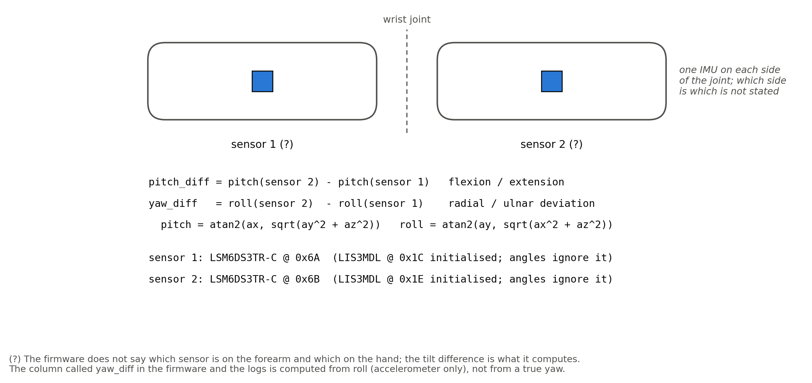
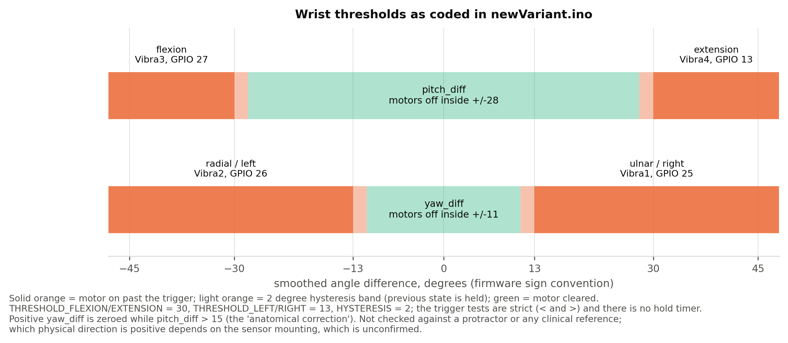

# Wrist glove: methods

What the final firmware, [`firmware/newVariant/newVariant.ino`](firmware/newVariant/newVariant.ino), does, read from the code. This page describes behaviour. It does not report any measurement of how well the behaviour matches a real wrist; no reference measurement exists (see [`../docs/LIMITATIONS.md`](../docs/LIMITATIONS.md)).

## 1. Sensors and rates

| item | value in the code |
|---|---|
| Board | ESP32, I2C on GPIO 21 (SDA) and 22 (SCL), `TwoWire I2C_1`, serial 115200 baud |
| Sensor 1 | LSM6DS3TR-C (accel + gyro) at 0x6A, LIS3MDL (magnetometer) at 0x1C |
| Sensor 2 | LSM6DS3TR-C at 0x6B, LIS3MDL at 0x1E |
| Accelerometer | range 4 g, data rate 26 Hz |
| Gyroscope | range 250 dps, data rate 26 Hz (read, never used) |
| Magnetometer | range 4 gauss (read, never used) |

Both magnetometers and both gyroscopes are initialised and read on every loop, but no angle depends on them. `Madgwick` filter objects are constructed and started at 26 Hz and then never called. The header comment in the sketch calls them "reserved". The accelerometer is the only sensor that affects the output.

The firmware does not say which sensor sits on the forearm and which on the hand. The relative order matters, because the output is `sensor 2 minus sensor 1`. That placement is not recorded anywhere in the repo.



## 2. Angles

Accelerometer readings are converted to units of g (divided by 9.80665). For each sensor:

```
pitch = atan2(ax, sqrt(ay^2 + az^2))     in degrees
roll  = atan2(ay, sqrt(ax^2 + az^2))     in degrees
```

The wrist angles are differences between the two sensors:

```
raw_pitch_diff = pitch2 - pitch1      flexion / extension
raw_yaw_diff   = roll2  - roll1       radial / ulnar deviation
```

- **The "yaw" is a roll.** The variable and the log column are called yaw, but it is the difference of two roll angles. Gravity carries no information about rotation around the vertical axis, so an accelerometer-only design cannot measure true yaw. Treat `yaw_diff` as "sideways tilt difference".
- **No drift, but sensitive to motion.** Tilt from gravity does not integrate, so it cannot drift the way a gyroscope angle does. When the hand accelerates, the accelerometer measures gravity plus that acceleration, and the tilt estimate is then wrong for as long as the acceleration lasts. The low-pass filter in section 4 reduces, but does not remove, that.
- **The subtraction assumes the two boards have matching axes.** If one board is rotated relative to the other, the difference is not a clean wrist angle. The repo has no photo or drawing that shows how the boards were mounted.

## 3. Startup calibration

On every boot, after the SD card and the optional time sync (section 7), `runCalibration()` runs while the LED ring pulses blue:

1. Discard the first 0.5 s (sensors settling).
2. For the next 3.0 s, compute `raw_pitch_diff` and `raw_yaw_diff` from both accelerometers each pass and accumulate them. A pass ends with `delay(20)`, so there are at most about 150 samples.
3. Set `pitch_offset` and `yaw_offset` to the averages, and reset the smoothing state to 0.
4. Flash the ring green three times and start tracking.

From then on every angle is measured relative to the pose held during those 3 s. The prompt printed on the serial port is "Hold wrist straight and flat for 3 seconds". A calibration made in a different pose shifts every threshold with it. One recording in `data/` has a median pitch of 17.8 degrees, which that could explain, but the cause was not established ([`../data/README.md`](../data/README.md)).

## 4. Smoothing

```
pitch_diff = raw_pitch_diff - pitch_offset
smooth     = 0.85 * smooth + 0.15 * pitch_diff        (SMOOTH_ALPHA = 0.15)
```

and the same for yaw. The offset is subtracted first, then the result is low-passed. The filter runs once per `loop()` pass, not once per unit of time. The loop is not paced and its rate was not measured, so the real time constant of this filter is not known. The sensors only produce new data at 26 Hz.

## 5. Anatomical correction

```
if (pitch_diff > 15 && yaw_diff > 0)  yaw_diff = 0
```

The code comment says that bending the wrist up makes it deviate to the right, so positive yaw is suppressed when pitch is above half of the extension threshold (15 degrees). The effect is visible in the data: in `W_0712_1732.CSV`, 2263 of 4398 rows have a yaw of exactly 0, and 2253 of those have a pitch above 15. Whether the premise is right for the wearer was not checked.

## 6. Alert rules

There is no hold timer: a motor turns on in the same loop pass in which the smoothed value crosses its threshold. The smoothing is the only delay.

| axis | direction (label in the code) | motor, GPIO | turns on when | turns off when |
|---|---|---|---|---|
| pitch | flexion ("down") | Vibra3, 27 | pitch_diff < -30 | -28 < pitch_diff < +28 (clears both pitch motors) |
| pitch | extension ("up") | Vibra4, 13 | pitch_diff > +30 | same |
| yaw | left / radial | Vibra2, 26 | yaw_diff < -13 | -11 < yaw_diff < +11 (clears both yaw motors) |
| yaw | right / ulnar | Vibra1, 25 | yaw_diff > +13 | same |

- Thresholds are `THRESHOLD_FLEXION` 30, `THRESHOLD_EXTENSION` 30, `THRESHOLD_LEFT` 13, `THRESHOLD_RIGHT` 13, with `HYSTERESIS` 2, all in degrees.
- Between the "off" band and a threshold (for example 28 to 30 degrees) nothing changes, so a motor that was on stays on and one that was off stays off.
- The two axes are independent, so two motors can run together (for example flexion and ulnar deviation).
- Motors are driven with `digitalWrite(HIGH/LOW)`: full on or off, no pattern and no strength control.
- Which anatomical direction "down", "up", "left" and "right" mean depends on how the boards are mounted and which hand wears the glove. The code comments give the labels above. They have not been checked against a real wrist.



## 7. Time sync and file names

At boot the ESP32 joins a WiFi network for up to 10 s, asks `pool.ntp.org` for the time (up to 5 s more), then switches WiFi off. The network name and password are constants near the top of the sketch. In this repo they are placeholders (`YOUR_WIFI_SSID`, `YOUR_WIFI_PASSWORD`).

- If the sync works, the log is `W_MMDD_HHMM.CSV` (`W_0715_1422.CSV` is 15 July, 14:22). If that name exists, `_2`, `_3`, ... is appended.
- If it fails, the log is `LOG_NNNN.CSV`, numbered from 0001.
- The time zone call is `configTime(-8 * 3600, 3600, ...)`: UTC-8 plus a fixed one-hour daylight offset, so the clock reads UTC-7 all year. In winter it is one hour ahead of Pacific standard time.

## 8. Logging

- One row every 500 ms. The file is opened, appended to, flushed and closed for each row, so a power loss costs at most one row.
- The current firmware starts a file with `# Session started: <time or "Unknown (no WiFi sync)">` and `# Device: Wrist Posture Monitor`, then the header `elapsed_sec,pitch_diff,yaw_diff,vibra_active`. The recordings in `data/` come from an earlier build and have no `#` lines.
- `elapsed_sec` is `millis() / 1000`, whole seconds since power-on. It includes the boot, time-sync and calibration time and is not wall-clock time.
- `pitch_diff` and `yaw_diff` are the smoothed, corrected values, one decimal place.
- `vibra_active` is 1 if any motor flag was set. The row is written before that pass's trigger decision, so the flag reflects the previous pass: a one-loop lag.
- After 50,000 rows (`MAX_ROWS`; about 6.9 hours at one row per 0.5 s) a new file is started.

## 9. LED ring

A 16-LED NeoPixel ring on GPIO 32 (moved from GPIO 12, which is also the SPI MISO pin on this board; the sketch comments describe the corruption of SD writes that this caused) at brightness 25 of 255.

- Each axis gets a signed severity from -1 to +1. It is 0 inside a dead zone of half the threshold (15 degrees for pitch, 6.5 degrees for yaw, `DEAD_ZONE_FRAC` 0.50) and grows linearly to +/-1 at the threshold.
- LED 14 faces pitch-down, LED 6 pitch-up, LED 2 yaw-left and LED 10 yaw-right. Every LED's colour comes from the dot product of its direction with the severity vector: green at 0, yellow around 0.5, red at 1. LEDs on the opposite side stay green.
- During startup calibration the ring pulses blue; after it, three green flashes.

## 10. USB serial protocol

Used by the desktop app ([`../desktop-app/`](../desktop-app/)). Commands are lines that start with `CMD:`; anything else is ignored.

| command | reply |
|---|---|
| `CMD:HANDSHAKE` | `WRIST_DEVICE_V1` |
| `CMD:LIST` | every `.CSV` file in the SD root, one per line, then `END` |
| `CMD:DOWNLOAD:<file>` | the file, line by line, then `EOF` (`ERROR:FILE_NOT_FOUND` first if missing) |

The firmware also prints `PitchDiff: x | YawDiff: y` on every loop pass, which shares the same serial port.

## 11. Comments in the firmware that this repo does not rely on

- The block above the threshold constants cites maximum ranges of motion, OSHA and "ergonomic guidelines", and a median-nerve "danger zone" of 20 degrees. None of these was checked against a source, so the repo does not repeat them. The 30 and 13 degree values are the author's choices.
- The comments next to `deadDown`, `deadUp`, `deadLeft` and `deadRight` give values that do not match the constants (35 x 0.70 and so on). The values in section 9 are computed from the constants.
- The `MAX_ROWS` comment says about 2.9 days. At one row per 0.5 s it is about 6.9 hours.
