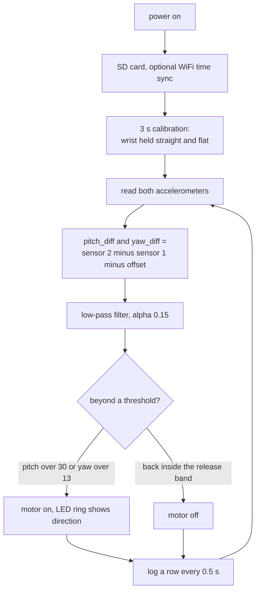

# Wrist glove

A wearable that measures how far the wrist is bent and buzzes a motor when the bend goes past a set angle. It was built as a wrist-rehabilitation aid: the idea is a reminder that the wrist has left a chosen range, not a measurement tool.

> **Status: working prototype, not validated.**
>
> - The firmware does what its constants say (see [`METHODS.md`](METHODS.md)). Seven development recordings in [`../data/`](../data/) are consistent with that: the motors switch on near the configured 30 and 13 degree thresholds, and a device lying still stays within 1.3 degrees of zero.
> - **No accuracy has been measured.** There is no protractor, goniometer, motion-capture or clinician reference for any angle. Nobody has checked that "30 degrees" in the log is 30 degrees of wrist.
> - **No outcome has been measured.** The repo makes no claim that using the glove changes how a wrist heals or moves.
> - The "yaw" in the code and logs is the difference of two roll angles from an accelerometer, not a true yaw.
> - This is not a medical device. See [`../docs/LIMITATIONS.md`](../docs/LIMITATIONS.md).

## How it works

Two small IMU boards (accelerometer, gyroscope and magnetometer each) sit on either side of the wrist. The firmware turns each accelerometer into a tilt angle, subtracts one from the other, and treats the difference as the wrist angle. It holds the pose from the first 3 s after power-on as zero.



The four motors map to four directions (flexion, extension, left, right), and the two axes work independently. The 16-LED ring shows the same information as a colour that goes from green to red. Full details, with the exact formulas, are in [`METHODS.md`](METHODS.md).

| item | value |
|---|---|
| Board | ESP32 |
| Sensors | 2 x LSM6DS3TR-C + LIS3MDL, on one I2C bus |
| Used by the output | the accelerometers only |
| Thresholds | 30 degrees (flexion, extension), 13 degrees (left, right), 2 degrees hysteresis |
| Alert delay | none beyond the low-pass filter |
| Logging | microSD CSV, one row per 0.5 s; USB transfer to the desktop app |

## Structure

```
wrist-glove/
  firmware/newVariant/newVariant.ino   CURRENT: the final firmware
  METHODS.md                           angles, calibration, filter, alert rules, log format, USB protocol
  HARDWARE.md                          pin map, I2C addresses, block diagram, what is not recorded
  images/                              diagrams made by ../tools/make_diagrams.py
../archive/wrist-prototypes/           superseded: cloud build with a flex sensor and Madgwick filter
../data/                               development recordings and their summary
../desktop-app/                        viewer for the logs
```

## Things to know before building one

- The sketch ships with the placeholders `YOUR_WIFI_SSID` and `YOUR_WIFI_PASSWORD`. WiFi is used only at boot for the clock. If it fails, the glove still runs and names its files `LOG_NNNN.CSV`.
- Which sensor is on the forearm and which is on the hand is not recorded. Swapping them flips the sign of both angles.
- Motor driver circuit, power source and enclosure are not documented ([`HARDWARE.md`](HARDWARE.md), "Not documented").
- The versions of the Arduino core and libraries were not recorded.
